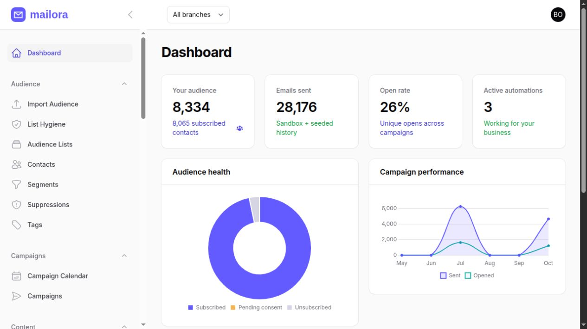
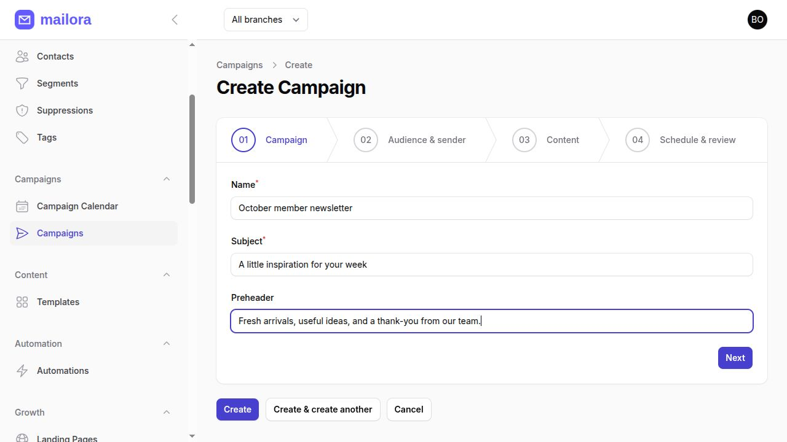
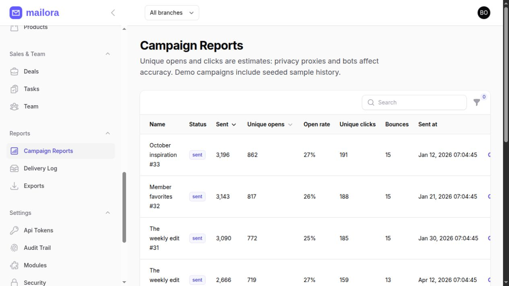
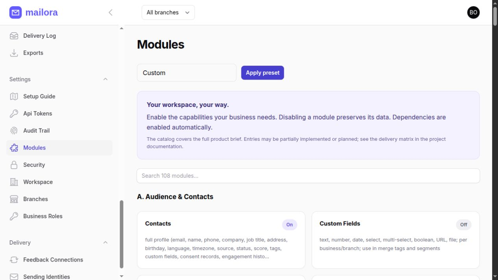
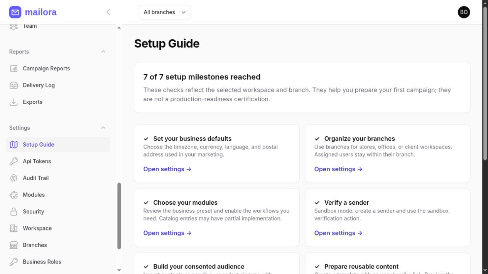

<div align="center">

<h1>Email marketing, with room for your business to grow.</h1>
<p>Bring audiences, campaigns, automation, and branch operations into one workspace you control.</p>
<p><strong>PHP 8.3+ · Laravel 12 · Filament 3 · MySQL / SQLite · Redis / Horizon</strong></p>
<p><a href="#see-mailora-in-action">Screenshots</a> · <a href="#what-you-can-do-today">Features</a> · <a href="#local-quick-start">Get started</a> · <a href="docs/STATUS.md">Delivery status</a> · <a href="docs/DEPLOYMENT.md">Deploy</a></p>
</div>



*Actual application screenshot using fictional demo data. Counters include sandbox activity and seeded sample history.*

## Why Mailora?

Marketing work often spans spreadsheets, design tools, inboxes, and handoff messages. Mailora puts the core audience-to-campaign workflow in one Laravel application: collect contacts, organize consented audiences, prepare reusable content, review campaigns, queue delivery, and inspect results.

- **Organize by business and branch.** Separate stores, offices, or agency clients with scoped records and role permissions.
- **Reuse your work.** Start from templates, lists, segments, and versioned automation steps.
- **Make handoffs visible.** Request campaign reviews, leave comments, approve changes, and inspect audit records.
- **Reduce repetitive administration.** Queue imports, exports, email checks, and follow-up actions.
- **Own your deployment.** Run locally with SQLite or use the supplied PHP/nginx/MySQL/Redis containers.
- **Start safely.** Sandbox delivery renders campaign messages without delivering them to real recipients.

> **Release status:** this is a working application under active development, not the finished 108-module specification. Features below work to the stated scope. The catalog also includes partial features and planned modules. Review the [delivery matrix](docs/STATUS.md) before production rollout.

## Who can use it?

| Business | Available workflow | Opportunity |
|---|---|---|
| Retail stores | Segment consented customers, prepare promotions, keep product/order records, collect surveys | Build repeatable communications around your own audience |
| Agencies | Separate client work by branch, assign access, review drafts, export reports | Standardize delivery and reduce repeated setup |
| SaaS teams | Collect signups, trigger supported onboarding steps, update tags/scores, create tasks | Keep early customer communication consistent |
| Newsletter publishers | Reuse templates, manage preferences, schedule broadcasts, inspect metrics | Spend more time on editorial work |
| Educators and event organizers | Publish signup pages, register webinar attendees, provide calendar invites | Keep registration and audience records together |
| Local businesses and nonprofits | Maintain consent records, send approved announcements, gather feedback | Reduce spreadsheet-based audience administration |

These are supported use cases, not promises that every industry-specific workflow is automated. Payments, native commerce sync, SMS/WhatsApp, SSO, and advanced automation remain outside the delivered core.

## What you can do today

| Area | Delivered capabilities |
|---|---|
| **Workspaces & access** | Business isolation, branches/switcher, inherited settings, role checks, editable business roles, team records, presets, module dependencies, guided setup |
| **Audience** | Profiles, tags/custom JSON, lists/membership editing, rule-based segments, pending-by-default CSV imports, suppression, consent history, profile exports, unsubscribe/preferences |
| **List hygiene** | Queued syntax/DNS routing checks, common typo suggestions, role-address flags, configurable disposable domains; findings never grant consent |
| **Campaigns** | Four-step wizard, audience/sender/template selection, scheduling, approval, review requests/rejection/comments, static pre-send checks, duplicate, pause/resume/cancel, monthly calendar |
| **Content** | HTML editor, reusable templates, basic block builder, escaped personalization/fallbacks, sanitized previews, shared templates, snippets |
| **Automation** | Versioned runs; contact-created, confirmed-form, and manual triggers; wait, tag/remove-tag, score, task, field update, tag condition, unsubscribe, email actions; immutable published email snapshots |
| **Sending** | Sandbox, SMTP, sender/domain checks, per-recipient consent/suppression, monthly quotas/rate limits, message logs, plain-text parts, unsubscribe headers |
| **Feedback** | Generic HMAC-signed delivery/bounce/complaint receipts, timestamp validation, replay-safe processing, original-recipient suppression, encrypted signing secrets/rotation |
| **Reports** | Signed click redirects, open pixels, basic bot heuristics, tracking switch, campaign metrics/date filters, charts, queued CSV/PDF exports with private expiring downloads |
| **Growth** | Hosted double-opt-in forms, basic landing pages, surveys with session deduplication, webinar capacity/registration/ICS, short links, coupon records/redemption service |
| **Business records** | Products, orders, deals, tasks, tickets, help articles, invoices with minor-unit calculations/PDF, manual attendance, time entries |
| **AI** | Queued text generation via AI Hub, provider/model settings, token reservation/settlement, generation history, disabled-provider handling; credentials required |
| **Security & operations** | TOTP/recovery codes, scoped expiring API tokens, audits, CSRF protection, sanitization, security headers, queue/scheduler, health checks, Docker and CI definitions |

The automation editor is a reorderable step editor, not a full canvas. DNS checks do not certify inbox placement. Hygiene does not prove mailbox existence. Product/order/ticket/attendance screens are basic records, not full ERP integrations. Generic feedback needs an MTA/gateway adapter emitting Mailora's format.

## See Mailora in action

Captured from the running application, with fictional demo data.

### From draft to campaign



### Reporting and workspace controls

| Campaign reporting | Module manager |
|---|---|
|  |  |
| Inspect stored metrics and queue exports. | Choose modules while preserving records. |

### A guided start and a public-facing product

| Setup guide | Public home page |
|---|---|
|  |  |
| Milestones reflect actual workspace records. | Actual public page; its hero contains an illustrative product graphic. |

The admin images show the real interface, not generated mockups. [Full screenshot set and capture notes](docs/images/README.md).

## Where it can save time

**No customer time-saving study has been performed.** Savings depend on volume, current processes, training, hosting, and maintenance.

| Repetitive work | How Mailora helps |
|---|---|
| Rebuilding campaign layouts | Reuse templates and personalize fields |
| Sorting lists for every campaign | Save list memberships and segment conditions |
| Following up after signups | Publish supported automation steps once |
| Checking whether a draft was reviewed | Keep comments and review status beside the campaign |
| Assembling campaign spreadsheets | Queue CSV/PDF exports |
| Checking addresses individually | Queue advisory hygiene checks |
| Repeating team setup | Use presets and branch settings |

**Illustrative estimate, not a measured result:** if templates avoid 30 minutes on each of 4 monthly campaigns, exports avoid 20 minutes on 2 reports, and automation avoids 5 minutes on 8 follow-up tasks, that is **200 minutes (3 hours 20 minutes) per month**, before subtracting setup and maintenance.

`Monthly net time saved = Σ(task frequency × minutes avoided) − setup/training/maintenance minutes`

Measure before/after workflow times in your own business. This example is not a promise. Hosting, SMTP, AI, support, and maintenance costs still apply.

## How complete is it?

The original brief contains **108 broad modules**.

| Classification | Count | Meaning |
|---|---:|---|
| Partial implementation | 73 | A working flow, shared capability, or basic records exist; full scope unfinished |
| Adapter only | 2 | Package interface without the complete end-user workflow |
| Catalog only | 33 | Manifest/flag exists; requested workflow not delivered |
| Entire original module specification accepted as complete | 0 | No blanket completion claim |

This is **not an engineering-completion percentage**: modules vary enormously in size and share code. See [all 108 delivered/remaining-scope rows](docs/STATUS.md).

## Local quick start

Requirements: PHP 8.3 or newer, Composer 2, Node.js 22 or newer, npm, and SQLite for the simplest local setup. PHP needs the extensions required by `composer.lock`, including PDO/SQLite, mbstring, XML/DOM, ctype, fileinfo, OpenSSL and intl. See [package integration notes](docs/PACKAGES.md) for PDF renderer requirements.

```bash
composer install
cp .env.example .env
php artisan key:generate
npm ci
npm run build
```

In `.env`, keep the default SQLite connection and set:

```dotenv
APP_URL=http://127.0.0.1:8000
APP_ENV=local
APP_DEMO=true
MAIL_SANDBOX=true
MAIL_MAILER=log
QUEUE_CONNECTION=database
```

Install the schema and local sample data:

```bash
php artisan app:install --demo
php artisan serve --host=127.0.0.1 --port=8000
```

Run these in separate terminals so queued work and automation timers execute:

```bash
php artisan queue:work --tries=5 --timeout=240
php artisan schedule:work
```

Open [the application](http://127.0.0.1:8000) or [the admin login](http://127.0.0.1:8000/admin/login). A non-demo installation uses `php artisan app:install`; create the first business through `/admin/register`. Do not run the demo seeder against operational data.

## Demo accounts and data

Every seeded account uses the password **`password`**, solely for a local demo. The owner, analyst, and branch manager also have local demo shortcuts at `/demo` when `APP_DEMO=true`.

| Email | Role | Scope |
|---|---|---|
| `owner@demo.test` | Business Owner | Acme Retail, all branches |
| `admin@demo.test` | Admin | Acme Retail, all branches |
| `manager@demo.test` | Branch Manager | Acme Retail, Dhaka Store |
| `marketer@demo.test` | Marketing Manager | Acme Retail |
| `editor@demo.test` | Campaign Editor | Acme Retail |
| `designer@demo.test` | Content/Designer | Acme Retail |
| `automation@demo.test` | Automation Specialist | Acme Retail |
| `analyst@demo.test` | Analyst | Acme Retail, read access |
| `sales@demo.test` | Sales Rep | Acme Retail |
| `support@demo.test` | Support Agent | Acme Retail |
| `finance@demo.test` | Finance/Billing | Acme Retail |
| `client@demo.test` | Client | One PixelCraft Agency branch |
| `superadmin@demo.test` | Super Admin | Acme workspace and Horizon permission; no full platform console |

The default seed creates three businesses and nine branches. `DEMO_CONTACTS=25000` rounds up across three businesses, producing 25,002 contacts. It also creates 42 lists, 72 template records, 120 campaign records, 27 sample automation flows, 15 signup forms and commerce/growth examples. Templates reuse six content structures; the counts do not imply 72 independently designed templates. Campaign metrics are sample data, not actual delivered messages. All sample contact addresses use reserved `.test` domains.

```bash
# Destructive: only on an expendable local demo database.
php artisan demo:reset
php artisan demo:simulate-engagement
```


## Your first end-to-end campaign

1. Open **Settings → Setup Guide** and review defaults, branches, and modules.
2. Create a list/segment from contacts with recorded consent. Imports/API creation do not assume permission.
3. Create a sender with a postal address. Use sandbox verification locally; DNS verification for live SMTP.
4. Prepare a template containing `{{unsubscribe_url}}` and preview it.
5. Create a campaign, choose audience/sender, and save.
6. Run the pre-send checklist; request review, comment, and approve.
7. Choose **Queue send** with the worker running. Sandbox output appears in **Reports → Delivery Log**.
8. Inspect metrics or queue an export. Pending jobs recheck paused/cancelled campaigns.

A supported automation: **confirmed signup → add tag → wait → send approved template → create team task**. Published runs preserve email content snapshots.

## Safe delivery

`MAIL_SANDBOX=true` is the default. Live campaigns require SMTP credentials, HTTPS, recent domain verification, postal address, approval, and consented recipients. Keep workers and scheduler running.

SMTP cannot guarantee exactly-once delivery. An interrupted or ambiguous attempt is held as uncertain instead of blindly retried. A signed feedback receipt can reconcile it. Read [operations](docs/OPERATIONS.md) before enabling live delivery.

No real inbox acceptance, reputation, production throughput target, payment settlement, or complete multilingual PDF/font matrix is claimed as tested. Privacy proxies and bots affect open/click accuracy.

## API and integrations

| Method | Endpoint | Purpose |
|---|---|---|
| GET | `/api/v1/contacts` | Cursor-paginated contact access |
| POST | `/api/v1/contacts` | Create a pending contact |
| POST | `/api/v1/events` | Submit a supported automation event |
| POST | `/feedback/{endpoint}` | Generic signed receipt; separate HMAC authentication |

Owners/admins can create expiring scoped tokens under **Settings → API Tokens**. API endpoints also check roles/modules and enforce throttling. Never put credentials in client-side JavaScript. See [API.md](docs/API.md) and [FEEDBACK.md](docs/FEEDBACK.md).

Seven required Imran packages are installed behind interfaces: Drutogoti, Laravel Admin Panel, AI Catalog, AI Hub, Attendance Hub, Unicode PDF, Universal Slug. Actual usage and limits are in [PACKAGES.md](docs/PACKAGES.md). Installing a package does not implement every possible integration.

## Deployment and maintenance

- **Local:** PHP, SQLite, database queues.
- **Containers:** PHP 8.3 FPM, nginx, MySQL 8.4, Redis, Horizon, scheduler.
- **Queue configuration:** retry interval 300 seconds; worker timeout 240 seconds.
- **Private files:** preserve shared storage for imports/exports; never expose private storage publicly.
- **Backups:** preserve database, storage, necessary Redis state, and encryption key. Test restores in sandbox.
- **Updates:** install locked dependencies, build, back up, migrate, synchronize modules, restart workers, verify health.

Follow [DEPLOYMENT.md](docs/DEPLOYMENT.md) for exact commands, TLS/proxies, containers, backups, and recovery. Never enable demo shortcuts on operational installations.

## Verification

```bash
composer validate --strict
vendor/bin/pint --test
vendor/bin/phpstan analyse --no-progress --memory-limit=1G
php artisan test --compact
npm ci
npm run build
php artisan health:check
```

In restricted environments, PHPStan `--debug` avoids its parallel-worker socket.

Latest local verification (2026-10-28): **63 tests passed, 263 assertions; Larastan level 6 has zero errors; Pint and the Vite build pass.**

Tests cover tenant/branch isolation, module dependencies, approvals, consent/suppression, message idempotency, immutable automation snapshots, TOTP/recovery, API scopes, import/export privacy, public forms, tracking, signed feedback, hygiene, and reviews. Passing tests do not constitute a complete security audit or a claimed 80% coverage result.

PHP/nginx images, MySQL migrations, HTTP login/registration/health, Horizon and scheduler were smoke-tested locally. The earlier 56-test suite passed on MySQL 8.4; newer workflow regressions were verified on SQLite. Normal Compose networking could not run locally because Podman's `pasta` helper was unavailable; isolated host-network smoke tests were used. Remote GitHub Actions has not been run from this workspace.

## Full product catalog

This is the **planned product map**, not a list of fully finished features. Each module has a delivered/remaining-scope row in [STATUS.md](docs/STATUS.md).

<details>
<summary><strong>A. Audience & Contacts</strong> — 13 modules</summary>

- **1. Contacts** — partial
- **2. Custom Fields** — partial
- **3. Lists & Groups** — partial
- **4. Tags** — partial
- **5. Segments** — partial
- **6. Import / Export** — partial
- **7. Email Verification & List Hygiene** — partial
- **8. Suppression & Compliance Lists** — partial
- **9. Preference Center** — partial
- **10. Consent & Compliance (GDPR/CAN-SPAM/CASL/PECR)** — partial
- **11. Lead Scoring** — partial
- **12. Contact Enrichment** — adapter
- **13. Duplicate Management** — catalog only

</details>

<details>
<summary><strong>B. Campaigns</strong> — 14 modules</summary>

- **14. Campaigns (Regular broadcasts)** — partial
- **15. A/B & Multivariate Testing** — catalog only
- **16. Scheduled & Recurring Campaigns** — partial
- **17. Send-Time Optimization** — catalog only
- **18. Throttling & Warm-up** — partial
- **19. Transactional Email** — catalog only
- **20. Plain-text & Multipart** — partial
- **21. Campaign Approval Workflow** — partial
- **22. Campaign Calendar** — partial
- **23. Campaign Folders, Duplicate, Archive, Bulk actions** — partial
- **24. Pre-send Checklist & Spam Score** — partial
- **25. Test Sends & Inbox Preview** — partial
- **26. SMS & WhatsApp Campaigns (omnichannel add-on)** — catalog only
- **27. Web Push Notifications (optional)** — catalog only

</details>

<details>
<summary><strong>C. Content & Design</strong> — 9 modules</summary>

- **28. Drag-and-Drop Email Builder** — partial
- **29. Code Editor** — partial
- **30. Template Library** — partial
- **31. Dynamic Content & Personalization** — partial
- **32. Media Library** — catalog only
- **33. Brand Kit** — catalog only
- **34. Snippets / Saved Blocks / Signatures** — partial
- **35. Multi-language Content** — partial
- **36. AI Content Studio** — partial

</details>

<details>
<summary><strong>D. Marketing Automation</strong> — 9 modules</summary>

- **37. Visual Automation Builder** — partial
- **38. Triggers** — partial
- **39. Actions** — partial
- **40. Prebuilt Automation Recipes** — partial
- **41. Autoresponders & Drip Courses** — partial
- **42. Customer Journeys Map** — catalog only
- **43. Event Tracking API & JS Snippet** — partial
- **44. Webhooks (in & out)** — catalog only
- **45. Workflow Tasks & Alerts** — partial

</details>

<details>
<summary><strong>E. Forms, Landing Pages & Growth</strong> — 10 modules</summary>

- **46. Signup Forms Builder** — partial
- **47. Landing Page Builder** — partial
- **48. Surveys & Polls** — partial
- **49. Lead Magnets / Content Gate** — catalog only
- **50. Referral & Viral Programs** — catalog only
- **51. Giveaways / Contests** — catalog only
- **52. Webinar / Event Registration** — partial
- **53. Coupons & Promo Codes** — partial
- **54. QR Codes & Short Links** — partial
- **55. Social Sharing & "View in Browser" pages** — catalog only

</details>

<details>
<summary><strong>F. Sales, CRM & Commerce Light</strong> — 7 modules</summary>

- **56. Mini-CRM** — partial
- **57. Shared Inbox / Reply Management** — catalog only
- **58. Product Catalog** — partial
- **59. Orders & Revenue Attribution** — partial
- **60. E-commerce Connectors** — catalog only
- **61. Recommendations Engine** — catalog only
- **62. Subscriptions / Memberships (optional)** — catalog only

</details>

<details>
<summary><strong>G. Deliverability & Infrastructure</strong> — 8 modules</summary>

- **63. Sending Identities & Domains** — partial
- **64. SMTP & Provider Connections** — partial
- **65. Bounce, Complaint & Feedback-Loop Processing** — partial
- **66. Deliverability Dashboard** — catalog only
- **67. Dedicated IP / IP Pool Management (optional)** — catalog only
- **68. Link Tracking & Custom Tracking Domain** — partial
- **69. Unsubscribe Handling** — partial
- **70. Email Queue Engine** — partial

</details>

<details>
<summary><strong>H. Analytics & Reporting</strong> — 10 modules</summary>

- **71. Campaign Reports** — partial
- **72. Automation Reports** — partial
- **73. Contact & Audience Analytics** — partial
- **74. Revenue & ROI Dashboard** — catalog only
- **75. Real-time Activity Feed** — catalog only
- **76. Custom Reports & Dashboards** — catalog only
- **77. Scheduled Reports** — catalog only
- **78. Exports** — partial
- **79. AI Insights** — catalog only
- **80. Benchmarks** — catalog only

</details>

<details>
<summary><strong>I. Team, Agency & Operations</strong> — 10 modules</summary>

- **81. Team Management** — partial
- **82. Agency / Client Portal** — partial
- **83. Approvals & Comments** — partial
- **84. Tasks & Project Board** — partial
- **85. Attendance & HR (optional module)** — partial
- **86. Time Tracking & Productivity (optional)** — partial
- **87. Notifications Center** — partial
- **88. Audit Log & Activity Log** — partial
- **89. Knowledge Base / Help Center** — partial
- **90. Support Tickets (optional)** — partial

</details>

<details>
<summary><strong>J. Billing, Plans & Platform (SaaS mode)</strong> — 7 modules</summary>

- **91. Plans & Subscriptions** — partial
- **92. Payment Gateways** — catalog only
- **93. Invoices & Receipts** — partial
- **94. Usage Metering & Quotas** — partial
- **95. Email Credits / Pay-as-you-go (optional)** — catalog only
- **96. Affiliate / Reseller Program (optional)** — catalog only
- **97. Super Admin Console** — partial

</details>

<details>
<summary><strong>K. Platform Services</strong> — 11 modules</summary>

- **98. Public REST API** — partial
- **99. Webhooks Manager** — catalog only
- **100. Integrations Hub** — catalog only
- **101. Data Scraping & Lead Intelligence** — adapter
- **102. Localization** — partial
- **103. White-label & Custom Domains** — catalog only
- **104. Backup, Restore & Data Portability** — partial
- **105. Security Center** — partial
- **106. Feature Flags & Experiments** — catalog only
- **107. Health & Monitoring** — partial
- **108. Onboarding & Setup Wizard** — partial

</details>

## Roadmap priorities

Remaining engineering includes full acceptance of the 108-module brief, native provider/commerce integrations, payments/subscriptions, a visual automation canvas, A/B testing, omnichannel delivery, full localization, sophisticated analytics, abuse controls, and measured performance/coverage targets. These are not features unlocked by toggling a flag.

## Documentation

| Guide | Contents |
|---|---|
| [Delivery matrix](docs/STATUS.md) | Every module, working scope and gaps |
| [Architecture](docs/ARCHITECTURE.md) | Tenant/module boundaries and state |
| [Data model](docs/ERD.md) | Mermaid ERD and table dictionary |
| [Operations](docs/OPERATIONS.md) | Sending, incidents, workers, commands |
| [Deployment](docs/DEPLOYMENT.md) | Docker/VPS, TLS, backup/restore |
| [API](docs/API.md) | Tokens, endpoints, examples |
| [Feedback](docs/FEEDBACK.md) | HMAC receipt contract |
| [Package adapters](docs/PACKAGES.md) | Integration APIs and limits |
| [Original specification](docs/REQUIREMENTS.md) | Complete requested scope |

## Contributing

Use PHP 8.3-compatible code and locked dependencies. Add regression tests for business rules and tenant boundaries; run Pint, Larastan and relevant tests. Include disabled-module behavior and background-job authorization. Never commit secrets, customer exports, or backups. Use synthetic screenshot data.

Bug reports should include workflow, expected/actual behavior, and reproducible steps without private data. No hosted support SLA is implied.

## Author and license

Developed by **Imran Ahmed** · [imrandev.bd](https://imrandev.bd) · [me@imrandev.bd](mailto:me@imrandev.bd).

Application source uses the [MIT License](LICENSE). Third-party packages retain their own authorship/licenses. Commercial use is permitted by MIT; operating costs and third-party terms remain your responsibility.

## 🤝 Let's Connect & Collaborate

I am open to **Senior Remote Full-Stack Roles**, **AI Platform Architecture Contracts**, and **Enterprise Technical Advisory**.

**Timezone:** UTC+6 (Dhaka / Rangpur, Bangladesh) — Flexible overlap with US, UK, and European business hours.

**Delivery Mode:** Async-ready, Slack, Discord, Jira, GitHub, and production-first accountability.

| Channel | Address / Handle | Quick Action |
|---|---|---|
| 🌐 Primary Portfolio | imrandev.bd | [Visit Site ↗](https://imrandev.bd) |
| 📦 Packagist Packages | packagist.org/packages/imrandevbd/ | [View Packages ↗](https://packagist.org/packages/imrandevbd/) |
| 💼 LinkedIn Profile | linkedin.com/in/imranbru99 | [Connect ↗](https://www.linkedin.com/in/imranbru99) |
| 🐙 GitHub Profile | github.com/imranbru99 | [Follow ↗](https://github.com/imranbru99) |
| 💬 WhatsApp Direct | +880 1576-918420 | [Chat Now ↗](https://wa.me/8801576918420) |
| 📧 Direct Email | me@imrandev.bd | [Send Email ↗](mailto:me@imrandev.bd) |
| 🐦 X (Twitter) | @imrandev_bd | [Follow ↗](https://x.com/imrandev_bd) |
| 📺 YouTube Tech | @ImranDevBD | [Subscribe ↗](https://www.youtube.com/@ImranDevBD) |
