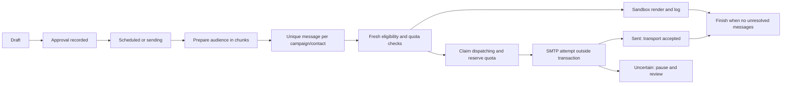

# Architecture

## Runtime and boundaries

The application uses Laravel 12, Filament 3, Livewire, Eloquent and Blade. Laravel 12 is the compatibility target for the installed package set; `composer.lock` pins the resolved dependencies and Composer's platform setting targets PHP 8.3. Public pages use Blade/CSS. The admin uses Filament's native components.

A business is the tenant. A branch belongs to a business. Authentication stores the business and optional assigned branch on the user; an unrestricted user can select a branch in the session. The current implementation does not offer a business switcher or full platform-wide business administration.

`TenantContext` is a scoped container service. `SetTenant` establishes it for authenticated requests, including persistent Livewire requests. Jobs carry explicit business, branch and record IDs and execute inside `TenantContext::run()`. The context is restored in a `finally` block, including after exceptions.

`BelongsToBusiness` adds a global business scope. Without a tenant context its query matches no rows. `BelongsToBranch` restricts branch-aware models when a branch is selected; shared templates with a null branch remain visible. Owners can use all-branches mode. Model save checks validate tenant-owned related records where defined. Global scopes are a safety layer; new controllers, raw SQL and any `withoutGlobalScopes()` use still require deliberate authorization review.

Business settings are overlaid with the selected branch's settings through `array_replace`, a shallow key override. Workspace and branch forms expose a subset of settings; this is not a schema-driven configuration UI for every catalog feature.

## Roles and account security

`User::allows(module, action)` is the permission entry point. Reserved owner, admin and superadmin roles receive broad workspace access. Other built-in roles have default capabilities, and business role records can supply explicit `module:action` permissions. The installed Spatie package is not the source of these authorization decisions.

Filament resources use `TenantResource` for module checks and authorization. Team and role administration have their own restricted resources. An API-only user cannot enter the admin panel. TOTP setup uses encrypted secrets, hashed recovery codes, a password check and replay prevention; the session is challenged after authentication when TOTP is enabled. This is optional user MFA, not an organization-wide SSO or forced-MFA policy engine.

## Module registry

`config/modules.json` and `app/Modules/*/module.json` describe 108 catalog entries. `ModuleCatalog` synchronizes definitions during installation/migration and through `modules:sync`, including a fresh non-demo install. Module definitions are stored in `modules`; business and branch overrides live in pivot tables. `ModuleRegistry` resolves defaults, dependencies and branch restrictions. Enabling a dependent enables its prerequisites. Disabling a prerequisite while an enabled dependent needs it fails. Core entries cannot be disabled. A toggle changes configuration without removing records.

Application components live centrally in `app/Services`, `app/Filament`, `app/Jobs` and shared migrations. The manifest directories do not yet have isolated providers, migrations, events, translations and test suites for every module. Several catalog entries describe related aspects of one implementation, so their independent toggles are not a promise of distinct controls. Consult [STATUS.md](STATUS.md) for delivered scope.

Navigation, resource routes, selected public routes and API routes check the relevant module. Sending and automation recheck their owning modules at execution time. Unsubscribe links deliberately continue to operate when modules are disabled so an opt-out remains possible. Enabling a catalog-only entry does not create a missing feature.

## Sending state and concurrency

`CampaignService` authorizes approval and launch. `PrepareCampaign` materializes the audience using chunks and a unique campaign/contact key, then queues pending messages. `SendMessage` rechecks campaign state, module state, sender, consent, suppression, pause preference and quota. A database transaction locks the business and message before claiming work, serializing quota mutation per business. Rate limiting additionally limits attempts per business/minute.

Sandbox execution stores rendered HTML, text and unsubscribe headers, consumes usage, and marks the message `sandbox`. Live execution first commits `dispatching`, then calls SMTP outside the transaction. A successful call marks `sent`. An exception marks `uncertain` and pauses the campaign. A killed process can leave `dispatching`; it is not blindly sent again.

This is an at-most-once **SMTP attempt** after a persisted claim, not an exactly-once delivery guarantee. It can require manual recovery when an attempt was not actually sent. A successful SMTP call does not prove inbox delivery. Bounce and complaint webhooks, transport reconciliation and provider-level idempotency are not implemented.

Monthly usage counts attempted/reserved live messages and completed sandbox messages, not confirmed inbox deliveries. Business-level locking favors consistency over maximum parallel throughput. No million-message benchmark has been performed.

## Rendering and tracking

`TemplateRenderer` sanitizes accepted HTML and escapes personalization values. Supported field merge tags and fallback syntax are limited; the renderer is not a full conditional template language. The basic builder renders five block types. Unsubscribe URLs use opaque per-contact tokens. Rendered messages have a postal address and unsubscribe headers.

Tracking rewrites eligible links to signed routes with server-stored destinations. Clients cannot provide a replacement destination. The open pixel and redirect update unique counts and event records; basic bot heuristics are not a reliable Apple Mail Privacy Protection classifier. Protected delivery previews run under a restrictive sandbox Content Security Policy.

## Automation state

An automation has a trigger, version and ordered step definitions. Publishing increments its version. Enrollment creates one run per flow/contact/version and snapshots the steps. Editing requires pausing; existing runs retain their snapshot. `automations:tick` advances due runs, at most one step per tick, inside a run lock.

Supported actions are wait in minutes, add/remove tag, bounded score change, task creation, unsubscribe, selected field updates, tag condition branches and template email. A run stops for missing/unsubscribed contacts and is capped at 1,000 history entries. Email actions use the normal campaign delivery guard. Publishing an email-bearing flow requires send permission.

The editor is an ordered repeater rather than a graphical canvas. Arbitrary event tracking, commerce triggers, webhook steps, business-hour waits, A/B splits and journey analytics are outside the implemented engine.

## Public data and background work

Published signup forms, landing pages, surveys, webinars, articles and short links resolve their opaque public ID and then establish the owning tenant and branch. Publication and module checks apply to those workflows. Public forms use validation, throttling and CSRF protection; signup also uses a honeypot. Survey repeat detection is session based, not verified-person identity.

CSV exports escape spreadsheet formula prefixes. The export center queues contact/campaign CSV and campaign PDF generation, stores files privately, and expires downloads after 24 hours; downloads check the requesting user as well as current tenant/module permissions. Signup double-opt-in confirmations are also queued, use signed 48-hour URLs, and use the log mailer in sandbox. CSV imports are queued, streamed from business-specific private storage and create pending contacts. Contact profile export and erasure cover the implemented profile flow; a complete organization-wide retention and data-subject-request system remains additional work.

Interfaces live in `app/Contracts`, adapters in `app/Support/Integrations`, bindings in `AppServiceProvider`. New jobs should establish and restore tenant context, authorize scope at enqueue time, recheck mutable delivery restrictions at execution time, and make retries safe for their side effects. See [PACKAGES.md](PACKAGES.md) for which adapters are invoked by an actual user workflow.
