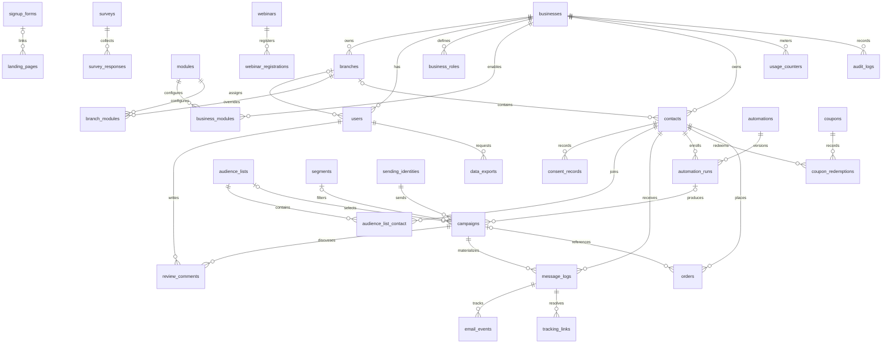

# Data model

This diagram highlights the implemented domain, not every column or the complete 108-module brief. Migrations are the authoritative schema. Most domain tables carry `business_id`, optional `branch_id`, an opaque `public_id`, timestamps, and where applicable `deleted_at`. Public IDs do not replace authorization checks.

## Data dictionary

| Tables | Purpose and important fields |
|---|---|
| `businesses`, `branches` | Organization, preset, settings JSON; branches inherit/override business settings; business monthly email allowance |
| `users`, `business_roles` | Business/branch assignment, role name, hashed password; encrypted TOTP secret, recovery hashes and last used time step; custom role permission strings |
| `modules`, `business_modules`, `branch_modules` | Catalog key/category/dependencies/core/default state and per-scope enabled/configuration records |
| `contacts` | Normalized email, profile, status, consent/legal basis, tags/custom JSON, score, locale/timezone, opaque unsubscribe token, pause/frequency preference |
| `audience_lists`, `audience_list_contact`, `segments` | Static memberships and JSON dynamic field rules; list membership is many-to-many |
| `suppressions`, `consent_records` | Business opt-out/block records and contact consent evidence |
| `contact_imports` | Private CSV source path, processing state, counts and bounded row-error summary |
| `templates`, `snippets` | Subject, HTML, block JSON and categories; snippets are separately managed content records |
| `sending_identities` | Sender address/name/domain, postal address, verification timestamps and ownership challenge |
| `campaigns` | Sender/audience references, content/tracking, approval, scheduling/state, aggregate counters and optional automation-run origin |
| `review_comments` | Business/branch-scoped campaign comments with author and body; used by campaign review workflow |
| `message_logs` | One campaign/contact delivery record; rendered HTML/text/headers, outcome, reason and timestamps |
| `email_events`, `tracking_links` | Message event records and opaque click tokens resolving server-stored destinations |
| `automations`, `automation_runs` | Trigger/step definitions and version; per-contact step snapshot, cursor, due time, status and execution history |
| `signup_forms`, `landing_pages` | Hosted form content/opt-in configuration and published page content with optional signup-form reference |
| `surveys`, `survey_responses` | Published question/options and answer with session-derived visitor hash |
| `webinars`, `webinar_registrations` | Event schedule/location/capacity and normalized attendee registrations |
| `coupons`, `coupon_redemptions` | Code, percentage/expiry/use limits and unique contact redemption |
| `short_links`, `articles` | Published short destination/click count or help article content; current public URLs use public IDs |
| `products`, `orders` | Basic catalog inventory/pricing and order total/status/contact/campaign reference; not an external storefront mirror |
| `deals`, `tasks`, `tickets` | Basic sales/task/support records; no full conversation or project engine |
| `invoices` | Customer, line-item JSON, integer minor-unit prices, tax percentage, currency and status |
| `custom_fields`, `tags` | Definition records; not all semantics are enforced by contact custom JSON |
| `attendance_entries`, `time_entries` | Manual punch and worked-time records |
| `plans`, `usage_counters`, `ai_generations` | Sample plan catalog, monthly email/AI counters and queued generation output/state; not a payment ledger |
| `data_exports` | Requesting user, type/reference, state, private storage path and expiry |
| `audit_logs` | Explicit business/user action log entries; not automatic coverage of every database write |

Laravel owns sessions, password reset tokens, Sanctum personal access tokens, cache/locks and queue/batch/failure tables. Drutogoti owns its published diagnostic tables; those are separate from the tenant application domain.

## Constraints and storage conventions

- Contact email and suppression email are unique per business. Email normalization is application behavior.
- Campaign/contact message keys are unique, as are automation/contact/version enrollment keys. These support retry-safe local bookkeeping.
- Survey/visitor, webinar/email and coupon/contact keys prevent repeated records within their stated identity model. A visitor hash identifies a browser session, not a person.
- Monthly usage is unique by business and period. Business locks serialize quota claims. Branch-specific limits do not have separate usage ledgers.
- Prices/totals use integer minor units where exposed. Currency remains a separate code; there is no exchange-rate conversion or payment settlement layer.
- Most identifiers are relational foreign keys, but selected references such as polymorphic export record IDs are application-validated. Tenant correctness also depends on the scopes and model/service guards described in [ARCHITECTURE.md](ARCHITECTURE.md).
- Soft deletes and suppression preservation are intentional. Backup retention, full account deletion and complete data portability require operational policies beyond deleting a profile row.

## Additional workflow tables

| Table | Purpose |
|---|---|
| review_comments | Business/branch-scoped campaign reviews with author and timestamp |
| email_checks | Latest advisory syntax/DNS result for each contact |
| feedback_endpoints | Scoped generic receipt endpoints with encrypted HMAC secrets |
| feedback_events | Idempotent gateway event IDs, message reference, processing status |

Message logs also store the original recipient email and delivered/bounced/complained timestamps. Campaigns maintain delivered and complaint counters alongside existing metrics.
